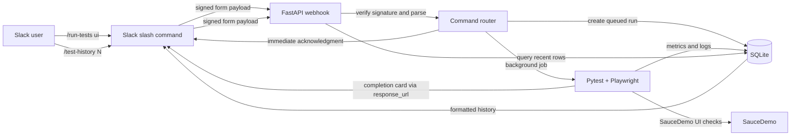
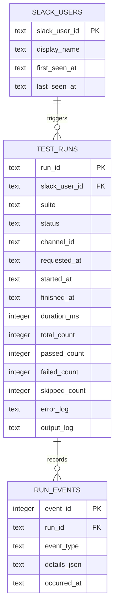

# System architecture

## Components

1. **Presentation layer — Slack**: `/run-tests ui` starts a run and `/test-history [N]` reads recent records. Slack Block Kit cards display run summaries. The service uses Slack's signed slash-command requests and response URLs.
2. **Application layer — FastAPI and Pytest**: `chatops_qa/app.py` validates and routes commands. `commands.py` parses a fixed command grammar. `runner.py` launches the SauceDemo suite as a subprocess after the initial Slack acknowledgment, then sends a completion card.
3. **Data layer — SQLite**: `slack_users` stores trigger identities, `test_runs` stores run state and metrics/logs, and `run_events` records request/start/finish audit events.

## Data flow

## Entity relationship

## Request lifecycle

Slack must be able to reach the local service over HTTPS. The endpoint verifies the HMAC against the exact raw body and rejects timestamps older than five minutes. It writes the run request to SQLite, acknowledges the slash command immediately, and lets the background task execute the browser suite. The final card is sent through Slack's short-lived `response_url`. `/test-history` returns an ephemeral response and defaults to the latest five records, with a maximum of twenty.
